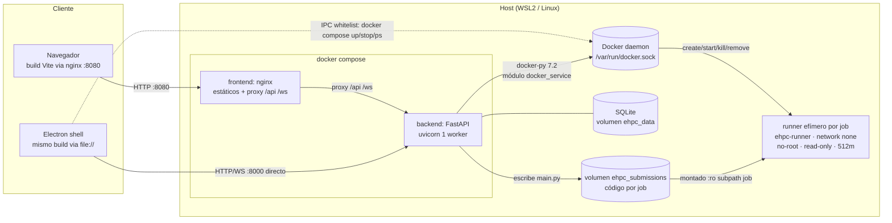

# Telar — Arquitectura del sistema

> **Estado: CONGELADO (Fase 1).** Este documento, junto con `api-contract.md` y
> `data-model.md`, es la fuente de verdad para los implementadores de Fase 3.
> Cualquier desviación requiere actualizar estos docs primero.
>
> Fecha: 2026-07-12 · Basado en la investigación de Fase 0
> (`docs/research/*.md`, `docs/analysis/*.md`).

---

## 1. Visión general

Telar es una plataforma educativa para aprender OpenMP con PyOMP. El estudiante
lee lecciones (derivadas de los 14 ejemplos del repo de aprendizaje), ejecuta
código PyOMP real en contenedores Docker efímeros y aislados, observa logs y
métricas en vivo, responde quizzes y sigue su progreso.

Componentes:

| Componente | Tecnología | Responsabilidad |
|---|---|---|
| Frontend | React + Vite + TS, servido por nginx (web) y por Electron (desktop) — **un único build** (`base: './'`, HashRouter) | UI: home, simulador, resultados, catálogo, lecciones/quizzes |
| Desktop shell | Electron ^43 + electron-builder ^26 + esbuild (main/preload) | Carga el mismo build; IPC con whitelist cerrada para `docker compose up/stop/ps` |
| Backend | FastAPI 0.139 + uvicorn (1 worker) + Python 3.12 | API REST + WebSocket, orquestación de jobs, persistencia SQLite |
| Runner | Imagen propia `ehpc-runner` (`python:3.12-slim` + `pyomp==0.5.1`, ~777 MB) | Ejecuta el código del estudiante; un contenedor efímero por job |
| Persistencia | SQLite vía aiosqlite (WAL) + fixtures versionados en código | Jobs, intentos de quiz, progreso; el contenido (ejemplos/lecciones/quizzes) vive en fixtures |

### 1.1 Diagrama de componentes



Versión ASCII (para la memoria impresa):

```
+-----------------+        +------------------+
|  Navegador      |  :8080 |  nginx           |
|  (build Vite)   +------->|  estáticos       |
+-----------------+        |  proxy /api /ws  |
                           +--------+---------+
+-----------------+                 | HTTP/WS
|  Electron shell |  :8000          v
|  (mismo build)  +------->+------------------+       +------------------+
+--------+--------+        |  FastAPI backend |<----->|  SQLite (WAL)    |
         | IPC whitelist   |  uvicorn 1 worker|       |  vol. ehpc_data  |
         | (compose up/    +--------+---------+       +------------------+
         |  stop/ps)                | docker-py (módulo docker_service)
         v                          v
+---------------------------------------------------------------+
|  Docker daemon (/var/run/docker.sock)                          |
|   +---------------------------------------------------------+ |
|   | runner efímero por job: ehpc-runner                     | |
|   | --network none --user 10001 --cap-drop ALL              | |
|   | --read-only + tmpfs /tmp | 512m | pids 128 | init       | |
|   | código en /work :ro (vol. ehpc_submissions, subpath)    | |
|   +---------------------------------------------------------+ |
+---------------------------------------------------------------+
```

---

## 2. Topología docker-compose

### 2.1 Modo desarrollo (diario, en WSL2)

En dev **el backend corre nativo en WSL** (uvicorn con reload) y el frontend en
el dev-server de Vite. Docker solo ejecuta runners. Esto elimina el dilema del
socket durante el desarrollo (docker-py habla con el socket local como el
usuario de WSL) y da HMR completo.

```
Vite dev server :5173  ──►  uvicorn :8000 (nativo WSL)  ──►  docker.sock  ──►  runners
Electron dev: carga http://localhost:5173 (VITE_DEV_SERVER_URL)
```

- Código del proyecto en `/mnt/d/universidad/tesis/e-hpc/`, pero
  `node_modules`, builds, la BD de dev y el directorio de jobs viven en ext4
  (`~/`): el FS 9p de `/mnt/d` multiplica ~10× los tiempos de I/O
  (medido en `pyomp-runner.md` §6).
- Entrega de código al runner en dev: el backend es un proceso del host, así
  que escribe `~/.ehpc/jobs/<job_id>/main.py` y lo bind-monta `:ro` — el
  daemon resuelve rutas del host sin ambigüedad.
- La imagen `ehpc-runner` se construye una vez: `docker compose --profile build build runner`.

### 2.2 Modo producción/demo (compose completo)

```yaml
# compose.yaml (sin clave `version:` — obsoleta en Compose v2+)
# REGLA DE SEGURIDAD: todos los puertos ligados a 127.0.0.1. El backend no
# tiene autenticación y monta el socket Docker: publicarlo en 0.0.0.0
# expondría ejecución de código y el historial a toda la LAN. Ningún puerto
# del stack debe escuchar fuera de loopback.
services:
  frontend:
    build: ./frontend            # multi-stage: node:22 build -> nginx:alpine (ver §10.2)
    ports: ["127.0.0.1:8080:80"]
    depends_on:
      backend:
        condition: service_healthy
    healthcheck:
      test: ["CMD", "wget", "-q", "--spider", "http://127.0.0.1:80/"]
      interval: 30s
      timeout: 5s
      retries: 3
    restart: unless-stopped

  backend:
    build: ./backend
    ports: ["127.0.0.1:8000:8000"]
    environment:
      EHPC_DB_PATH: /app/data/ehpc.db
      # 'null' es necesario para Electron (file://); riesgo residual documentado
      # en api-contract.md §0 — mitigado por el bind a loopback. Las variantes
      # 127.0.0.1 son OBLIGATORIAS: al abrir http://127.0.0.1:8080 el navegador
      # manda ese Origin (no 'localhost'), y sin ellas CORS/WS lo rechazan (BL-12).
      EHPC_ALLOWED_ORIGINS: "http://localhost:5173,http://localhost:8080,http://127.0.0.1:5173,http://127.0.0.1:8080,null"
      EHPC_CODE_DELIVERY: volume            # 'volume' (compose) | 'bind' (dev nativo)
      EHPC_SUBMISSIONS_VOLUME: ehpc_submissions
      EHPC_RUNNER_IMAGE: ehpc-runner:0.5.1
      EHPC_MAX_TIMEOUT_S: 0                 # 0 = sin límite (tope opcional)
      EHPC_MAX_CONCURRENT_JOBS: 2
    volumes:
      - ehpc_data:/app/data
      - ehpc_submissions:/submissions        # rw en backend; el runner lo monta :ro
      - /var/run/docker.sock:/var/run/docker.sock   # ver §5 (riesgo documentado)
    healthcheck:
      # python-urllib: python:3.12-slim no trae curl/wget.
      # /health devuelve 200 aunque falte la imagen runner (liveness, no
      # readiness — api-contract.md §2.1): sin esto, el primer arranque
      # dejaría al backend unhealthy y nginx jamás arrancaría.
      test: ["CMD", "python", "-c",
             "import urllib.request,sys; r=urllib.request.urlopen('http://127.0.0.1:8000/health', timeout=3); sys.exit(0 if r.status==200 else 1)"]
      interval: 10s
      timeout: 5s
      retries: 5
      start_period: 15s
    restart: unless-stopped

  # Imagen del runner: se CONSTRUYE con compose pero NO corre como servicio
  # (la instancia el backend por la API, un contenedor efímero por job).
  runner:
    build: ./runner
    image: ehpc-runner:0.5.1
    profiles: ["build"]          # `docker compose --profile build build runner`
    entrypoint: ["true"]

volumes:
  ehpc_data:
  # `name:` explícito (BL-02): sin él Compose antepone el prefijo del proyecto
  # (`<proyecto>_ehpc_submissions`) y el runner montaría un volumen vacío
  # distinto del que escribe el backend → todos los jobs fallan con "no such
  # file or directory". Debe coincidir con EHPC_SUBMISSIONS_VOLUME.
  ehpc_submissions:
    name: ehpc_submissions
```

> **Variante empaquetada (escritorio, solo Electron).** El despliegue de
> escritorio usa un compose DISTINTO
> (`desktop/resources/compose/compose.yaml`, ver `electron-spec.md` §6.1) que
> **NO** incluye el servicio `frontend`/nginx: Electron sirve la UI desde disco
> (`loadFile` sobre el recurso empaquetado `app-frontend` → `file://`) y habla
> directo al backend en `127.0.0.1:8000`, así que un contenedor nginx (estáticos
> + proxy) sería redundante. nginx sigue presente solo en el compose web/raíz de
> arriba.

### 2.3 nginx.conf (claves)

```nginx
server {
    listen 80;
    root /usr/share/nginx/html;
    index index.html;

    client_max_body_size 1m;        # 1ª barrera contra uploads grandes (límite real: 256KB en FastAPI)

    # SPA con HashRouter: no necesita fallback, pero se deja por robustez
    location / { try_files $uri $uri/ /index.html; }

    # El RuntimeFooter web consulta /health (sin prefijo /api): proxy explícito
    location = /health { proxy_pass http://backend:8000; }

    location /api/ {
        proxy_pass http://backend:8000;
        proxy_set_header Host $host;
        proxy_set_header X-Forwarded-For $proxy_add_x_forwarded_for;
    }

    location /ws/ {
        proxy_pass http://backend:8000;
        proxy_http_version 1.1;                     # requisito WS
        proxy_set_header Upgrade $http_upgrade;     # handshake Upgrade
        proxy_set_header Connection "upgrade";
        proxy_read_timeout 3600s;                   # jobs largos: no cortar el stream
        proxy_send_timeout 3600s;
    }
}
```

Config de origen del API en el frontend — **resolución en RUNTIME, no en el
build** (el build es ÚNICO para web y desktop; hornear un valor rompería la
otra plataforma):

```ts
// config.ts — regla congelada
const isDesktop = typeof window.ehpc !== 'undefined' || location.protocol === 'file:'
export const API_BASE = import.meta.env.VITE_API_BASE      // override SOLO de dev
  ?? (isDesktop ? 'http://localhost:8000' : '')             // web: mismo origen (proxy nginx)
export const WS_BASE  = import.meta.env.VITE_WS_BASE
  ?? (isDesktop ? 'ws://localhost:8000'
                : `${location.protocol === 'https:' ? 'wss' : 'ws'}://${location.host}`)
```

- **Web via nginx**: `''` → rutas relativas `/api/...`, `/ws/...` (proxied).
- **Electron**: `file://` no tiene origen → `http://localhost:8000` directo
  (CORS permite `"null"` con `allow_credentials=False`).
- `VITE_API_BASE`/`VITE_WS_BASE` quedan solo como override opcional de dev.

---

## 3. Flujo completo de un job (del click a los resultados)

```mermaid
sequenceDiagram
    autonumber
    participant UI as Frontend
    participant API as FastAPI (REST)
    participant WS as FastAPI (WS /ws/jobs/{id})
    participant DS as docker_service (módulo único)
    participant D as Docker daemon
    participant R as runner (contenedor efímero)
    participant DB as SQLite

    UI->>API: POST /api/v1/jobs {example_id|code, threads}
    API->>API: valida (pydantic, ≤256KB, threads ≤ max, ejemplo habilitado)
    API->>DB: INSERT job (status=queued)
    API->>API: asyncio.create_task(_run) + registro en app.state.jobs
    API-->>UI: 202 {job_id, ws_url}
    UI->>WS: conecta /ws/jobs/{id}
    WS-->>UI: status queued (snapshot + backlog si reconecta)

    Note over API: semáforo MAX_CONCURRENT_JOBS
    API->>DS: escribir main.py (volumen/bind) y lanzar runner
    DS->>D: containers.create + start (flags sandbox §4)
    WS-->>UI: status creating
    D->>R: start (tini PID 1)
    DS->>DS: threads daemon: logs (backpressure) + stats (lossy)
    WS-->>UI: status compiling  (proceso vivo, aún sin stdout)
    R-->>DS: primer byte de stdout
    WS-->>UI: status running
    loop en vivo
        R-->>DS: stdout/stderr (generador sync)
        DS-->>WS: asyncio.Queue → log (flush ~100ms, corte 256KB)
        D-->>DS: stats ~1/s
        DS-->>WS: metrics (lossy, call_soon_threadsafe)
    end
    alt cliente cancela
        UI->>WS: {"type":"cancel"}
        WS->>DS: container.kill()  (mata proceso y cierra streams)
    else timeout duro
        DS->>D: wait(timeout) lanza ReadTimeout → kill()
    end
    DS->>D: wait → exit_code · reload → OOMKilled
    Note over DS: stdout/stderr finales = buffer acumulado por el drainer (§3.2)<br/>— ya truncado a 256KB; NO se relee container.logs()
    DS->>DB: UPDATE job (status final, exit_code, stdout, parsed_timings, metrics_summary)
    WS-->>UI: status completed|failed|timeout|cancelled
    WS-->>UI: eof → close(1000)
    DS->>D: remove(force=True, v=True) en finally
    UI->>API: GET /api/v1/jobs/{id}  (resultados, speedup parseado)
```

Puntos no negociables del flujo (todos verificados en Fase 0):

1. **`asyncio.create_task` + registro en `app.state.jobs`** — nunca
   `BackgroundTasks` (no da handle para cancelar/consultar) y siempre se guarda
   la referencia al task (trampa del GC de asyncio).
2. **`auto_remove=False` + `remove(force=True)` en `finally`** — `auto_remove`
   crea carreras que pierden logs/exit code (issues docker-py #1813/#2655).
3. **Puente sync→async**: docker-py es 100% síncrono. Logs con
   `run_coroutine_threadsafe(queue.put(...), loop).result(timeout=5)`
   (backpressure contra el **drainer del job**, §3.2 — NUNCA contra un
   cliente WS; el `.result()` lleva timeout + re-chequeo de flag de fin para
   que el thread jamás quede bloqueado para siempre); métricas con
   `loop.call_soon_threadsafe(queue.put_nowait, ...)` (lossy: perder una
   muestra de 1/s es aceptable). Sentinela EOF comparado por identidad.
4. **Desconexión del cliente**: tarea lectora concurrente +
   `asyncio.wait(FIRST_COMPLETED)`; las pendientes se cancelan siempre.
5. **Para terminar streams se mata el contenedor**: cancelar el task de asyncio
   no desbloquea el `next()` del thread; `kill()` cierra a la vez ejecución,
   log-stream y stats-stream.
6. **Timeout duro**: `wait(timeout=N)` explícito (el timeout global del cliente
   docker es 120 s) → captura `ReadTimeout`/`ConnectionError` → `kill()` →
   `wait(5)` para el exit code real (137).
7. **Exit code 137 se desambigua** con `container.reload()` →
   `attrs["State"]["OOMKilled"]` antes de `remove`.
8. **Reaper de huérfanos**: en el lifespan de arranque,
   `containers.list(all=True, filters={"label": "ehpc.runner=true"})` → `remove(force=True)`,
   y todo job `queued/creating/compiling/running` en DB sin contenedor vivo →
   `failed` con `error_detail="orphaned_on_restart"`. Además borra **todos**
   los directorios de código huérfanos (`/submissions/*` en compose,
   `~/.ehpc/jobs/*` en dev): son efímeros por definición y tras un crash el
   `finally` del job nunca corrió.
9. **`log_config` del runner**: cada contenedor runner se crea con
   `log_config={"type": "json-file", "config": {"max-size": "4m", "max-file": "1"}}`
   — defensa en profundidad contra print-floods que inflarían el disco del
   host (compatible: la persistencia NO relee `container.logs()`, ver §3.2).

### 3.1 Entrega del código al runner (decisión)

**NUNCA bind-mount de una ruta interna del contenedor backend**: el daemon
resuelve rutas del **host**, no del backend (trampa de contenedores hermanos,
`docker-py.md` §2.3). Estrategia con dos modos, encapsulada en `docker_service`
tras la config `EHPC_CODE_DELIVERY`:

| Modo | Cuándo | Mecanismo |
|---|---|---|
| `bind` | Backend nativo en WSL (dev) | Backend escribe `~/.ehpc/jobs/<job_id>/main.py` (ext4) y lo monta `{host_path: {"bind": "/work", "mode": "ro"}}` — el backend ES un proceso del host |
| `volume` | Backend en compose (prod/demo) | Volumen nombrado `ehpc_submissions` montado rw en el backend en `/submissions`; el backend escribe `/submissions/<job_id>/main.py`; el runner monta el volumen con `subpath=<job_id>` (docker-py ≥7.2) en `/work`, `:ro` |

Fallback documentado si `subpath` diera problemas: `put_archive` (create →
put_archive → start), pendiente de un spike porque con `read_only=True` el
destino debe ser escribible en el momento de la copia. El directorio
`/submissions/<job_id>` se borra en el `finally` del job (y el reaper del
arranque barre los huérfanos, punto 8).

### 3.2 Drainer por job: el consumidor SIEMPRE existe (regla crítica)

El consumidor de la `asyncio.Queue` de logs **jamás** es el handler WS: es
una tarea **drainer propia del job** (`job_runner`), creada junto al task del
job y viva desde `create/start` hasta `finish()`, haya cero, uno o N clientes
conectados. Responsabilidades del drainer:

1. Consume la cola del puente sync→async (el backpressure del productor es
   contra él; con el `.result(timeout)` del punto 3 el thread nunca queda
   colgado aunque el drainer muera).
2. Aplica el **presupuesto de 256 KB** (stdout+stderr): al excederse emite
   `error OUTPUT_TRUNCATED`, setea `kill_reason="output_limit"` y mata el
   contenedor.
3. Acumula `stdout`/`stderr` completos (hasta el presupuesto) — **esta es la
   única fuente** de lo que se persiste y se parsea al final; nunca se relee
   `container.logs()` post-mortem (evita cargar GBs si el daemon acumuló más;
   el `log_config` del punto 9 acota además el disco).
4. Alimenta el **ring-buffer** de backlog (~500 líneas) y el contador `seq`.
5. Acumula las muestras para `metrics_summary`.
6. Hace **fan-out**: replica cada mensaje a una cola por-conexión de cada WS
   suscrito (`Queue(maxsize=200)` por conexión, `put_nowait` lossy — un
   cliente lento pierde mensajes de SU cola, detectable por hueco de `seq`,
   sin frenar ni al drainer ni a otros clientes).

El handler WS queda reducido a: suscribirse (recibe snapshot + backlog),
bombear su cola por-conexión al socket, y una tarea lectora para `cancel`/
desconexión (`asyncio.wait FIRST_COMPLETED`).

### 3.3 Cancelación y `kill_reason` (clasificación determinista del 137)

Registro en memoria por job (`app.state.jobs[job_id]`): `{task, drainer,
cancel_requested: bool, kill_reason: 'none'|'cancel'|'output_limit'|'timeout'}`.

- **Cancel sobre `queued`**: el endpoint/WS setea `cancel_requested=True` y
  marca `cancelled` en DB. El task `_run` comprueba `cancel_requested`
  inmediatamente DESPUÉS de adquirir el semáforo y ANTES de
  `containers.create` → si está seteado, retorna sin ejecutar. Sin carrera:
  o el flag se ve (no se crea contenedor), o el job ya pasó a `creating` y el
  cancel sigue la vía kill. El estado **en memoria** se sincroniza en el mismo
  instante que la escritura en DB (precisión de 2026-07-19): `phase` pasa a
  `cancelled` de forma síncrona, antes de cualquier `await`, y se emiten
  `status` terminal + `eof` a los suscriptores ya conectados (pasos 2-3 de
  §3.4, idempotentes). Sin esto el handle seguía `queued` hasta que el task
  despertaba —minutos con jobs largos delante—, la cola sobrecontaba el job
  cancelado y un WS que conectara en esa ventana lo veía activo.
- **Cancel sobre job con contenedor**: se escribe `kill_reason="cancel"`
  ANTES de invocar `kill()`. Ídem `output_limit` (drainer) y `timeout`
  (watchdog). Prioridad si coinciden en la misma ventana:
  `cancel > output_limit > timeout` (primer escritor gana; los demás no
  sobrescriben).
- `finish()` deriva `status`/`error_detail` EXCLUSIVAMENTE de
  `kill_reason + exit_code + OOMKilled`:

| kill_reason | exit/OOM | status | error_detail |
|---|---|---|---|
| `cancel` | — | `cancelled` | `null` |
| `timeout` | — | `timeout` | `wall_timeout` |
| `output_limit` | — | `failed` | `output_limit_exceeded` |
| `none` | exit 0 | `completed` | `null` |
| `none` | OOMKilled | `failed` | `oom` |
| `none` | exit ≠ 0 | `failed` | `null` |
| `none` | excepción docker-py | `failed` | `sandbox_error` (detalle solo en logs del servidor) |

- **Guard de estados terminales**: `finish()` y `set_phase()` ejecutan
  `UPDATE … WHERE id=? AND status NOT IN ('completed','failed','timeout','cancelled')`;
  0 filas afectadas ⇒ transición rechazada (nadie sobrescribe un terminal).

### 3.4 Orden de terminación (sin ventana ciega para el WS)

Secuencia estricta al terminar un job:

```
1. finish() escribe DB (status terminal + resultado)      [guard §3.3]
2. drainer emite `status` terminal + `eof` a TODAS las colas por-conexión
3. se cierran las colas por-conexión (los handlers WS hacen close 1000)
4. remove(force=True) del contenedor + borrado del dir de código (finally)
5. el job se marca cerrado; se retira de app.state.jobs tras la RETENCIÓN
```

El handler WS que conecta durante la transición: consulta registro →
si no está, consulta DB → si la DB no es terminal aún, reintenta UNA vez tras
~100 ms → decide (activo: suscribir; terminal: replay + close 1000;
inexistente: 4404). Con el orden anterior ambos casos son exhaustivos.

**Retención del handle terminal** (añadida el 2026-07-19): el paso 5 se
difiere `TERMINAL_HANDLE_RETENTION_S` (10 s). Durante esa ventana el handle
sigue en el registro pero con `closed=True`: `get_active()` devuelve `None`
(nadie se suscribe a un job muerto) y `queued_count()` no lo cuenta, mientras
`get_finished()` lo expone al handler WS para servir el **backlog con los
`seq` y `ts` originales**. Motivo: el replay reconstruido desde el texto plano
de la DB no puede conservar la numeración, y una reconexión del cliente
(backoff 1s/2s/4s) caía justo en esa ventana — el dedupe por `seq` del cliente
descartaba el replay entero y la terminal quedaba vacía. Pasada la retención
el replay cae a la vía DB, ya documentada como sesión nueva en
`api-contract.md` §8.2.

---

## 4. Modelo de seguridad en capas del runner

El código del estudiante es **no confiable por definición**. El runner adopta
el patrón contenedor-efímero de glot.run/codapi (verificado en
`code-runners.md`) con una capa por amenaza:

| # | Flag / mecanismo | Amenaza mitigada |
|---|---|---|
| 1 | `network_mode="none"` | Exfiltración de datos, descarga de payloads, ataques a la red local/metadata |
| 2 | `user=10001` (useradd `runner`, sin shell) | Operaciones privilegiadas dentro del contenedor; archivos root en volúmenes |
| 3 | `cap_drop=["ALL"]` | Uso de capabilities del kernel (raw sockets, mknod, chown, ptrace…) |
| 4 | `security_opt=["no-new-privileges:true"]` | Escalada vía binarios setuid/setgid |
| 5 | `read_only=True` (rootfs) | Persistencia de malware, modificación del intérprete/librerías |
| 6 | `tmpfs={"/tmp": "rw,noexec,nosuid,size=64m"}` | Escritura ilimitada a disco (tmpfs vive en RAM y muere con el contenedor); `noexec` impide ejecutar droppers |
| 7 | `mem_limit="512m"` + `memswap_limit="512m"` (iguales ⇒ sin swap) | Agotamiento de memoria del host; el OOM-killer mata solo al runner |
| 8 | `pids_limit=128` | Fork bombs (cuenta procesos **y** threads por cgroup; 128 deja margen a los N hilos OMP + threads de CPython/Numba) |
| 9 | `nano_cpus`/`cpuset_cpus` = nº hilos elegido | Monopolizar CPU del host; además hace pedagógico el % de CPU (N hilos ≈ N·100%) |
| 10 | `ulimits`: `nofile=256`, `fsize=16MB` | Agotamiento de descriptores; archivos gigantes dentro del tmpfs |
| 11 | `init=True` (tini PID 1) | Zombies y procesos hijos de OpenMP que sobreviven al `kill` |
| 12 | Código montado `/work` **`:ro`** | Automodificación del código; escritura fuera de tmpfs |
| 13 | Timeout duro `wait(timeout)` + `kill` | Bucles infinitos, procesos dormidos (wall-clock, no CPU-time) |
| 14 | Truncado de output a 256 KB + kill | Inundación del backend/WS por `print` en bucle paralelo; deadlock de pipe |
| 15 | Labels `ehpc.runner=true`, `ehpc.job=<id>` + reaper al arranque | Contenedores huérfanos si el backend crashea |
| 16 | Imagen fija por constante; el usuario jamás influye en `HostConfig` | Inyección de parámetros hacia `containers.run` |
| 17 | `PYTHONUNBUFFERED=1`, `NUMBA_CACHE_DIR=/tmp/numba_cache`, `OMP_NUM_THREADS=NUMBA_NUM_THREADS=N` | (Robustez, no seguridad) logs en vivo; `cache=True` no revienta con rootfs ro; libomp no es cgroup-aware — sin la env var vería los 8 cores del host |

Notas:

- `--cpus` limita por quota CFS; `cpuset_cpus="0-{N-1}"` da cores enteros
  dedicados — preferido para que las mediciones de speedup sean reproducibles.
  Se aplican ambos coherentes con N.
- **Alcance real de esa reproducibilidad** (precisión de 2026-07-19, decisión
  deliberada): el rango arranca SIEMPRE en el core 0 y no se reparte por slot
  del semáforo, así que con `EHPC_MAX_CONCURRENT_JOBS > 1` dos jobs
  concurrentes de N hilos reciben ambos `0-{N-1}` y **comparten los mismos
  cores físicos**. Las cifras de speedup/eficiencia solo son comparables
  entre sí **ejecutando un job a la vez**; bajo concurrencia siguen siendo
  válidas como ejecución, pero no como medición. Se descartó asignar
  `cpuset` disjuntos por slot: exigiría acoplar el semáforo al
  `docker_service` (hoy sin estado compartido) y repartir cores del host
  entre jobs de tamaño distinto, complejidad que no compensa en una
  plataforma didáctica de un solo usuario. El uso pedagógico (ver N hilos ≈
  N·100 % de CPU) no se ve afectado.
- `omp_set_num_threads(n)` desde el código del estudiante puede pedir más hilos
  que N: solo produce oversubscription dentro de su propia cuota, no escape.
  Los 3 ejemplos de barrido interno dependen de esto (ver §7).
- El runner **jamás** monta el socket Docker ni comparte volúmenes escribibles
  entre estudiantes (un caché Numba compartido sería vector de pickle-RCE,
  `code-runners.md` §6.3).

---

## 5. Riesgo del socket Docker y su aislamiento

**El riesgo**: montar `/var/run/docker.sock` en el backend equivale a darle
root del host — quien controle el socket puede crear un contenedor
`--privileged` con `/` montado. El código del **estudiante** nunca ve el socket
(el runner no lo monta); la superficie es un compromiso del propio backend
(RCE vía bug de FastAPI/dependencias).

**Mitigación arquitectónica — módulo único aislado `docker_service`**:

- Todo acceso a docker-py vive en **un solo módulo** (`app/services/docker_service.py`).
  Ningún router, repositorio ni servicio importa `docker` directamente.
- El módulo expone una API estrecha y tipada:
  `run_job(job_id, code_path, threads, timeout_s) -> JobExecution`,
  `kill(job_id)`, `reap_orphans()`, `ping()`, `image_present()`.
- Imagen, flags de sandbox y límites son **constantes del módulo**; ninguna
  entrada del usuario llega a `HostConfig` (solo `threads` ya validado 1..max
  y el timeout acotado por tope servidor, patrón doble-tope de Judge0).
- Cliente creado una vez en lifespan:
  `docker.from_env(version="auto", timeout=120, max_pool_size=50)`
  (cada stream de logs/stats retiene una conexión del pool).

**Endurecimiento opcional de despliegue** (documentado, no default):
`tecnativa/docker-socket-proxy` en red interna del compose; el backend usa
`DOCKER_HOST=tcp://socket-proxy:2375` sin cambios de código (docker-py lee la
env var). Limitación honesta: filtra endpoints, no payloads — reduce
superficie (sin volúmenes, redes, exec en otros contenedores) pero un backend
comprometido con `POST /containers/create` permitido aún puede pedir un
contenedor privilegiado. Complementos futuros: gVisor (`runtime="runsc"`) para
el runner, rootless Docker. Todo esto se discute en la memoria como análisis
de riesgo consciente.

---

## 6. Decisiones y alternativas descartadas

| Decisión adoptada | Alternativa descartada | Razón del descarte |
|---|---|---|
| Vite existente + esbuild para main/preload + electron-builder | **electron-vite** | Asume ser dueño del build del renderer; obligaría a duplicar el pipeline del frontend web. El requisito es UN build para web y desktop; el shell es delgado (1 ventana, IPC mínimo) |
| WebSocket único multiplexado por job | **SSE (sse-starlette)** | SSE es unidireccional: cancelar exigiría endpoints aparte; `EventSource` no admite headers. WS es nativo en FastAPI (cero deps). SSE queda como plan B barato: el productor (threads+queue) es idéntico |
| Contenedor Docker efímero por job (patrón glot/codapi) | **Judge0 / Piston (isolate)** | isolate exige contenedor `privileged` + administración de cgroups — frágil sobre Docker en WSL2 y sobredimensionado (cola Redis+Postgres de Judge0). El overhead de ~300 ms/contenedor es irrelevante frente a los segundos de JIT de PyOMP |
| `python:3.12-slim` + `pip install pyomp==0.5.1` | **conda/miniconda** | Existe wheel cp312 manylinux_2_28 autocontenida (trae su propio `libomp.so` LLVM 20.1); verificado empíricamente. Conda añadiría cientos de MB y otra cadena de supply |
| Imagen propia con pin exacto | **`ghcr.io/python-for-hpc/pyomp:latest`** | Trae JupyterLab, no fija la versión de Python del tag; el runner debe ser mínimo y reproducible |
| aiosqlite + repository pattern sin ORM | **SQLModel/SQLAlchemy + Alembic** | ~4 tablas; el backend es async-first por los WS; SQL explícito tras interfaces de repositorio. Migración futura a Postgres = reimplementar repositorios, sin tocar lógica |
| `asyncio.create_task` + registro en `app.state.jobs` | **BackgroundTasks / Celery / arq** | BackgroundTasks es fire-and-forget sin handle (imposible cancelar/consultar). Celery/arq requieren broker y múltiples procesos — incompatible con registro en memoria y sobredimensionado para 1 máquina |
| docker-py (sync) + threads daemon + asyncio.Queue | **aiodocker** | No oficial, menos mantenido; el patrón executor son ~10 líneas y docker-py es el SDK de Docker. `janus` tampoco: el puente es trivial |
| `auto_remove=False` + remove explícito + reaper | **`auto_remove=True`** | Carrera documentada: el daemon borra el contenedor antes de leer logs/exit code (404) |
| Volumen nombrado con `subpath` / bind del host (según modo) | **bind-mount de ruta interna del backend** | El daemon resuelve rutas del HOST: montaría basura o fallaría (contenedores hermanos) |
| Caché JIT: no hornear; warm-up en los scripts | **hornear caché Numba en la imagen** | `@njit(cache=True)` + región `openmp` **falla** (`LiftedWith ... output_types`, verificado); además el caché se indexa por archivo fuente. Solo se hornean `.pyc` (`compileall`) |
| `loadFile` + HashRouter + CORS `"null"` | **servidor HTTP embebido en Electron** | Puerto abierto = superficie extra; `loadFile` es el patrón recomendado. Protocolo custom `app://` documentado como mejora futura |
| uvicorn 1 worker | **múltiples workers** | El registro de jobs vive en memoria (`app.state.jobs`); con N workers los WS caerían en el worker equivocado. Escalar = mover el registro a Redis (futuro) |
| Métricas de `docker stats` (contenedor completo) | **métricas por hilo** | cgroups v2 no expone `percpu_usage`; medir por hilo exigiría un agente dentro del runner. El % agregado (N hilos ≈ N·100%) ya visualiza el paralelismo |
| Estados propios (8 fases) | **estados numéricos de Judge0** | No hay veredicto de judge (no se compara output esperado); las fases `creating/compiling` son específicas del JIT de PyOMP |

---

## 7. Estrategia de medición de speedup

Principio (Numba 5-minute guide, verificado en `code-runners.md` §6): **la
primera llamada compila**. El wall-time del contenedor incluye arranque de
Python + import de numba (~0.8 s) + JIT (0.3–5 s) — sirve como presupuesto de
timeout, **nunca** como métrica de speedup.

### 7.1 Fuentes de tiempo, por clase de ejemplo

| Clase | Ejemplos | Estrategia |
|---|---|---|
| **Barrido interno 1/2/4/8** | `spmd` (piSpmd), `spmdCritical` (piSpmdCritical), `transporteParticulas` (transporteMonteCarlo) | Una sola ejecución produce la curva completa de escalado (fijan hilos con `omp_set_num_threads`, con warm-up previo). El backend parsea las 4 líneas y entrega `parsed_timings.kind="sweep"` → gráfica de speedup directa. Requieren `cpus = min(8, cores_host)` independientemente del slider (deshabilitado en UI) |
| **Auto-miden par paralelo/referencia** | `sumaVectores` (vs NumPy), `matrices` (vs BLAS), `stencilCalor` (paralelo vs serial) | Parsean sus dos tiempos internos (con warm-up). `stencilCalor` ya imprime su referencia serial. `sumaVectores`/`matrices` muestran SOLO su par openmp-vs-referencia en el MVP; la re-ejecución con `threads=1` para speedup vs 1 hilo queda como **mejora futura** (no hay UI ni contrato para vincular dos jobs — decisión registrada) |
| **No miden tiempo** | `primerEjemplo`, `for`, `entornoDatos`, `mandelbrot`, `monteCarloPi`, `tareas`, `fibonacciTareas`, `sumaVectoresGPU` | Sin gráfica de speedup. La UI muestra wall-time del job con disclaimer explícito «incluye compilación JIT». `for` y `piTask` además no hacen warm-up: su única llamada incluye el JIT — prohibido inferir rendimiento |

### 7.2 Parsers de los 6 scripts que auto-miden

Patrones exactos (formatos reales verificados en `examples-content.md` §6);
cada ejemplo declara su `parser_id` en los fixtures:

| parser_id | Ejemplos | Regex (por línea) |
|---|---|---|
| `sweep_pi` | spmd, spmdCritical | `hilos = (\d+) \| pi = ([\d.]+) \| tiempo = ([\d.]+) s` |
| `sweep_transporte` | transporteParticulas | `hilos = (\d+) \| tiempo = ([\d.]+) s \| transmitidas: ([\d.]+) % \| reflejadas: ([\d.]+) % \| absorbidas: ([\d.]+) %` |
| `pair_openmp_numpy` | sumaVectores | `tiempo openmp: ([\d.]+) s` · `tiempo numpy\s*: ([\d.]+) s` · `correcto\? (True\|False)` |
| `pair_openmp_blas` | matrices | `tiempo openmp\s*: ([\d.]+) s` · `tiempo np\.dot\s*: ([\d.]+) s` · `correcto\? (True\|False)` |
| `pair_parallel_serial` | stencilCalor | `tiempo paralelo: ([\d.]+) s` · `tiempo serial\s*: ([\d.]+) s` · `paralelo == serial\? (True\|False)` |
| `none` | resto | — (sin parseo de tiempos; se conservan asserts de corrección: `pi = 3.14159…`, `fib(35) = 9227465`, `correcto? True`) |

Reglas del parser:

1. Se aplica **al final del job** sobre el stdout completo (no en vivo); si el
   output fue truncado, no se parsea (`parsed_timings=null`).
2. Los scripts que imprimen desde `@njit` (`helloOpenMP`, `entornoDatos`)
   tienen orden de líneas **no determinista** — jamás asumir orden, solo
   conjunto.
3. `areaMandelbrot` produce a propósito valores irreproducibles en sus 3
   primeras corridas (esa ES la lección) — no tratarlo como error.
4. speedup(n) = t(1)/t(n); eficiencia(n) = speedup(n)/n. Calculados por el
   backend, entregados en `parsed_timings` (ver `api-contract.md`).

### 7.3 Hilos y CPUs coherentes

- El slider de hilos de la UI va de 1 a `min(8, cores)` (expuesto en
  `GET /api/v1/system`). Para ejemplos `threads_configurable=true`, el backend
  fija `--cpus=N`, `cpuset_cpus="0-{N-1}"` y **siempre**
  `OMP_NUM_THREADS=NUMBA_NUM_THREADS=N` (libomp no es cgroup-aware:
  verificado que con `--cpus=2` ve los 8 cores del host).
- 5 ejemplos ignoran `OMP_NUM_THREADS` (fijan hilos por código):
  `spmd`, `spmdCritical`, `transporteParticulas` (barren 1..8 ⇒ cpus=min(8,cores)),
  `monteCarloPi` (fija 4 ⇒ cpus=4) y `entornoDatos` (`num_threads(4)` ⇒ cpus=4).
  Sus fixtures declaran `threads_configurable=false` + `fixed_threads_note`;
  la UI deshabilita el slider y muestra la nota.
- Fases WS `creating → compiling → running` eliminan el "silencio del JIT"
  (~1–2 s en contenedor, medido): `compiling` = proceso vivo sin stdout aún;
  `running` = primer byte de stdout.
- `sumaVectoresGPU` está `enabled=false` por defecto (requiere GPU NVIDIA +
  gcc + `--gpus`; sin ellos aborta con excepción — no degrada a CPU).

### 7.4 Timeouts (tope servidor OPCIONAL)

| Parámetro | Default | Tope servidor |
|---|---|---|
| `timeout_s` por job | el del fixture del ejemplo (30–90 s según ejemplo; 60 s para código propio) | `EHPC_MAX_TIMEOUT_S` — **opcional**: `0` (por defecto) = sin límite; `> 0` = máximo. El mínimo (5 s) se valida siempre |
| Jobs concurrentes | `EHPC_MAX_CONCURRENT_JOBS=2` (semáforo asyncio) | cola interna máx. 10 → 429 |

Los timeouts absorben import + JIT (hasta ~5–20 s en funciones no triviales) +
cómputo real; jamás los 3–5 s típicos de un judge.

---

## 8. Frontend y desktop (resumen de contratos con el backend)

- Pantallas y datos que consumen (spec visual en `handoff-design.md`; el tema
  MPI/cluster del prototipo se adapta a OpenMP/hilos según su §13):
  - **Home**: jobs recientes (`GET /jobs?limit=3`), lecciones sugeridas y
    progreso (`GET /modules`, `GET /progress`).
  - **Simulador (idle)**: catálogo de presets (`GET /examples`,
    `GET /examples/{id}` para el preview de código), `GET /system` para el
    slider de hilos; crear job (`POST /jobs` | `POST /jobs/upload`).
  - **Simulador (live)**: WebSocket `/ws/jobs/{id}` (status/log/metrics) +
    cancelar.
  - **Resultados**: `GET /jobs/{id}` (exit code, tiempos parseados, speedup,
    observaciones derivadas), descarga `GET /jobs/{id}/output`.
  - **Catálogo**: `GET /modules` (8 módulos, 14 lecciones, progreso).
  - **Lección**: `GET /lessons/{id}` (markdown), quiz
    (`GET /lessons/{id}/quiz`, `POST .../attempts`), progreso
    (`PUT /progress/lessons/{id}`).
- Detección de plataforma: `window.ehpc === undefined` ⇒ web. En Electron,
  `window.ehpc` (contextBridge) expone exactamente
  `{ appVersion, platform, dockerStatus, dockerUp, dockerStop, openExternal }`
  (nombres finales de `electron-spec.md` §5.1; whitelist cerrada, `execFile`
  sin shell, validación de `senderFrame`).
- Seguridad Electron: `contextIsolation:true`, `nodeIntegration:false`,
  `sandbox:true`, CSP con `connect-src http://localhost:8000 ws://localhost:8000`,
  `will-navigate` whitelist, `setWindowOpenHandler` deny + `shell.openExternal`
  solo `https:`.

---

## 9. Estructura de repositorio (destino de Fase 3)

```
e-hpc/
├── compose.yaml
├── frontend/          # React+Vite+TS · Dockerfile multi-stage (node:22 → nginx)
│   └── nginx.conf
├── desktop/           # Electron: main.ts, preload.ts, electron-builder.yml
├── backend/
│   ├── Dockerfile
│   └── app/
│       ├── main.py            # FastAPI + lifespan (DB, docker client, jobs registry, reaper)
│       ├── config.py          # pydantic-settings (EHPC_*)
│       ├── routers/           # jobs.py, examples.py, lessons.py, quizzes.py, progress.py, system.py, ws.py
│       ├── services/
│       │   ├── docker_service.py   # ÚNICO módulo que importa docker (§5)
│       │   ├── job_runner.py       # orquestación del ciclo de vida del job
│       │   └── output_parser.py    # parsers §7.2
│       ├── repositories/      # jobs.py, quiz_attempts.py, progress.py, content.py
│       ├── db.py              # aiosqlite + PRAGMAs + schema.sql idempotente
│       └── content/           # fixtures versionados (ver data-model.md)
├── runner/
│   └── Dockerfile             # python:3.12-slim + pyomp==0.5.1 + smoke test
└── docs/
```

Convenios WSL2: repositorio en `/mnt/d`, pero `node_modules`, `dist`,
`~/.ehpc/` (DB y jobs de dev) y cachés (`ELECTRON_CACHE`) en ext4.
Empaquetado Windows: `electronuserland/builder:wine` en Docker o build final
en el host Windows.

---

## 10. Operativa (decisiones que Fase 3 NO debe inventar)

### 10.1 Dockerfile del backend y permisos del socket

`python:3.12-slim`, `pip install -r requirements.txt` (pineado, §10.4),
`uvicorn app.main:app --host 0.0.0.0 --port 8000`. **Decisión explícita: el
proceso corre como root DENTRO del contenedor backend** — riesgo aceptado y
documentado: un backend no-root no podría abrir `/var/run/docker.sock` (gid
del host, variable entre máquinas) sin `group_add` con GID configurable, que
complica el despliegue de la tesis sin reducir el riesgo real (quien tiene el
socket ES root del host, con o sin uid 0 en el contenedor). El aislamiento
real es §5 (módulo único) + bind a loopback + sandbox del runner.

### 10.2 Build del frontend: decisión única

El compose construye el frontend **dentro de Docker** (multi-stage
`node:22-slim` → `nginx:alpine`), ejecutando `docker compose build` desde el
**clon de trabajo en ext4** (`~/dev/e-hpc`) — nunca desde `/mnt/d` (contexto
9p lento). `frontend/.dockerignore` y `backend/.dockerignore` son
obligatorios (`node_modules`, `dist`, `dist-electron`, `.venv`,
`__pycache__`, `*.db`). electron-builder consume `frontend/dist/` generado
por `npm run build` en el mismo clon ext4 (mismo código ⇒ mismo build).

### 10.3 Makefile (raíz) — flujo dev multi-proceso

```
make dev-backend    # uvicorn app.main:app --reload (nativo WSL, ~/.ehpc)
make dev-frontend   # npm --prefix frontend run dev (Vite :5173)
make dev-desktop    # npm --prefix desktop run dev
make build-runner   # docker compose --profile build build runner
make build-images   # compose build frontend backend + runner
make up / make down # compose up -d / down
make test           # pytest backend + vitest frontend
make dist           # vite build + electron-builder --linux
```

### 10.4 Manifiesto backend (pins congelados)

`backend/requirements.txt`: `fastapi[standard]>=0.139,<0.140`,
`pydantic>=2.12,<3`, `pydantic-settings>=2.6,<3`, `docker>=7.2,<8`,
`aiosqlite>=0.20,<1`. Dev extra (`requirements-dev.txt`): `pytest`,
`pytest-asyncio`, `pytest-cov`, `httpx`.

### 10.5 Tabla única de variables de entorno `EHPC_*`

| Variable | Default | Usada por |
|---|---|---|
| `EHPC_DB_PATH` | `~/.ehpc/ehpc.db` (dev) / `/app/data/ehpc.db` (compose) | db.py |
| `EHPC_ALLOWED_ORIGINS` | `http://localhost:5173,http://localhost:8080,http://127.0.0.1:5173,http://127.0.0.1:8080,null` (incluye las variantes `127.0.0.1` — BL-12) | CORS + validación Origin del WS |
| `EHPC_CODE_DELIVERY` | `bind` (dev) / `volume` (compose) | docker_service |
| `EHPC_SUBMISSIONS_VOLUME` | `ehpc_submissions` | docker_service (modo volume) |
| `EHPC_JOBS_DIR` | `~/.ehpc/jobs` | docker_service (modo bind) |
| `EHPC_RUNNER_IMAGE` | `ehpc-runner:0.5.1` | docker_service |
| `EHPC_MAX_TIMEOUT_S` | `0` = **sin límite** (tope opcional; con `> 0` es el máximo de `timeout_s`) | validación jobs |
| `EHPC_MAX_CONCURRENT_JOBS` | `2` | semáforo job_runner |
| `EHPC_MAX_CODE_BYTES` | `262144` | validación jobs/upload |
| `EHPC_MAX_OUTPUT_BYTES` | `262144` | drainer (§3.2) |
| `EHPC_COMPOSE_DIR` | — (solo desktop) | electron-spec §5.3 |

El README raíz documenta: prerrequisitos (Docker, Node 22 vía nvm, Python
3.12), regla ext4, `make` targets, esta tabla, y el riesgo del socket (§5).

---

## 11. Estrategia de tests del backend (espejo del §10 del frontend-spec)

Objetivo ≥80% en `services/`, `repositories/`, `routers/`. La **costura de
inyección es obligatoria**: `job_runner` recibe el docker service por
interfaz `typing.Protocol` (`DockerServicePort`), nunca importa `docker`.

| # | Suite | Casos clave |
|---|---|---|
| 1 | `test_repositories.py` | contra `aiosqlite.connect(":memory:")` + schema.sql: CRUD jobs, guard terminal de `finish()`/`set_phase` (0 filas si ya terminal), upsert progreso, best_score |
| 2 | `test_docker_fake.py` + `FakeRunner` | fake scriptable del Protocol: guiones de `logs` (chunks temporizados), `stats`, `wait→exit_code`, `kill`, excepciones — reutilizado por todas las suites |
| 3 | `test_job_runner.py` (pytest-asyncio) | happy path; timeout (kill_reason=timeout); OOM (137+OOMKilled); truncado 256KB (kill_reason=output_limit, `parsed_timings=null`); cancel en queued (no crea contenedor) y en running; carrera cancel-vs-finish (guard); drainer sin clientes (no bloquea al productor); fan-out a 2 suscriptores |
| 4 | `test_ws.py` | TestClient de Starlette: snapshot+backlog al conectar, replay+close 1000 en terminal, 4404 inexistente, `cancel`, `BAD_CLIENT_MESSAGE` |
| 5 | `test_parsers.py` | los 6 parser_id contra los stdout LITERALES de `examples-content.md` §6 (fixtures en `tests/fixtures/stdout/`); orden no determinista; output truncado ⇒ null |
| 6 | `test_routers.py` | dependency overrides (fake runner + DB memoria): validaciones de §7.1/§7.2 del contrato (fuentes, filename estricto, threads, timeout), envelope, códigos de error |
| 7 | `test_content.py` | ContentRepository valida fixtures reales del repo: invariantes §4.4 de data-model |

---
