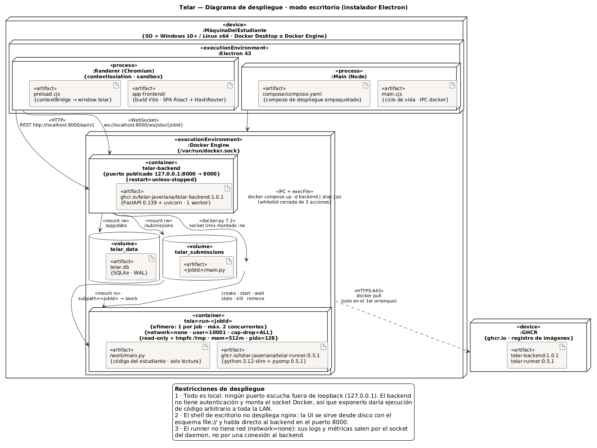
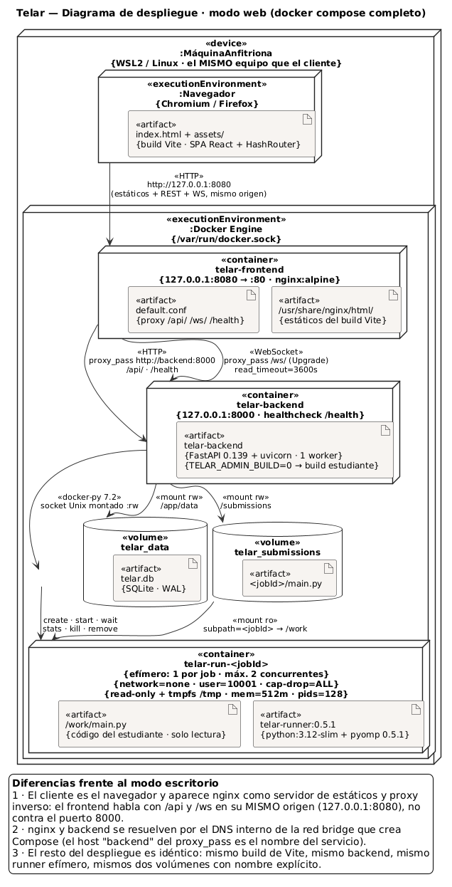
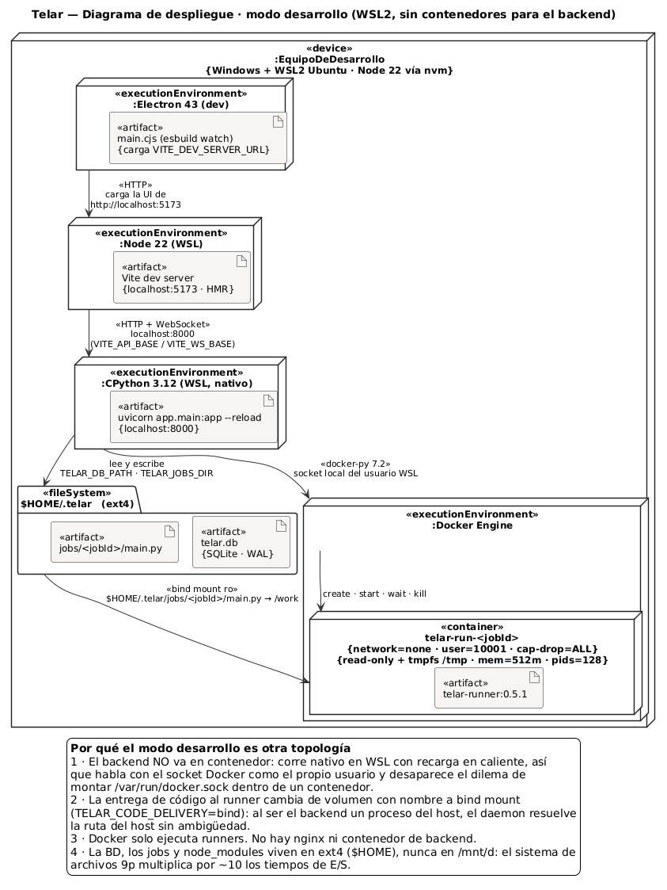

# Telar — Diagramas de despliegue (UML)

Vista de **despliegue** del sistema: qué nodos físicos y de ejecución existen,
qué artefactos se despliegan en cada uno y por qué protocolo y puerto se
comunican. Complementa el diagrama de **componentes** de
[`architecture.md` §1.1](architecture.md), que describe la estructura lógica y
no dice nada sobre dónde vive cada cosa en tiempo de ejecución.

Telar se despliega en **tres topologías distintas**, no en una. No son variantes
cosméticas del mismo dibujo: cambia quién sirve la UI, cambia si el backend vive
en un contenedor y cambia cómo llega el código del estudiante al runner. Por eso
hay un diagrama por modo.

| Modo | Cliente | Backend | Servidor de estáticos | Entrega de código al runner |
|---|---|---|---|---|
| [Escritorio](#1-modo-escritorio-instalador-electron) (lo que se distribuye) | Electron (`file://`) | contenedor `telar-backend` | ninguno (Electron sirve desde disco) | volumen `telar_submissions`, `subpath` |
| [Web](#2-modo-web-docker-compose-completo) | navegador | contenedor `telar-backend` | contenedor nginx `:8080` | volumen `telar_submissions`, `subpath` |
| [Desarrollo](#3-modo-desarrollo-wsl2) | Electron o navegador | `uvicorn` **nativo** en WSL | Vite dev server `:5173` | bind mount de `$HOME/.telar/jobs/` |

Lo que **no** cambia entre modos: es siempre un despliegue **de una sola
máquina**. No hay servidor remoto, no hay base de datos en red, no hay
multi-tenancy. Todos los puertos se ligan a `127.0.0.1` porque el backend no
tiene autenticación y monta el socket de Docker; publicarlo en `0.0.0.0` daría
ejecución de código arbitrario y acceso al historial a toda la LAN
(`compose.yaml`, regla de seguridad de cabecera).

## Notación

Se usa notación UML de despliegue estándar, con estereotipos:

| Estereotipo | Significado en Telar |
|---|---|
| `<<device>>` | Nodo físico: la máquina del estudiante, el registro GHCR. |
| `<<executionEnvironment>>` | Entorno de ejecución sobre el nodo: Electron, Docker Engine, CPython, Node. |
| `<<process>>` | Proceso del sistema operativo dentro de un entorno (main / renderer de Electron). |
| `<<container>>` | Contenedor Docker. Es un nodo anidado: tiene artefactos desplegados dentro. |
| `<<volume>>` | Volumen Docker con nombre (`database` en el dibujo). |
| `<<artifact>>` | Artefacto desplegable: una imagen, un build, un fichero de configuración, un `.db`. |
| Flecha continua | Camino de comunicación o de montaje, etiquetado con protocolo y puerto. |
| Flecha discontinua | Dependencia que solo ocurre en el primer arranque (`docker pull`). |

Las etiquetas de los nodos llevan entre llaves los valores reales del
despliegue (`{network=none · user=10001 · …}`), tomados de las constantes del
código, no del diseño.

---

## 1. Modo escritorio (instalador Electron)

Es el despliegue que se **distribuye**: un `.deb` / `.AppImage` / instalador NSIS
que el estudiante instala sobre su propio Docker.



Fuente: [`diagrams/despliegue-escritorio.puml`](diagrams/despliegue-escritorio.puml)
· SVG: [`despliegue-escritorio.svg`](../assets/deployment/despliegue-escritorio.svg)

### Nodos y artefactos

| Nodo | Artefactos desplegados | Origen en el repo |
|---|---|---|
| `:Electron 43` → `:Main (Node)` | `main.cjs`, `compose/compose.yaml` | `desktop/src/main.ts`, `desktop/resources/compose/compose.yaml` |
| `:Electron 43` → `:Renderer (Chromium)` | `app-frontend/` (build de Vite), `preload.cjs` | `frontend/dist/` copiado por `extraResources`, `desktop/src/preload.ts` |
| `<<container>> telar-backend` | imagen `ghcr.io/telar-javeriana/telar-backend:1.0.1` | `backend/Dockerfile` |
| `<<container>> telar-run-<jobId>` | imagen `ghcr.io/telar-javeriana/telar-runner:0.5.1` + `/work/main.py` | `runner/Dockerfile` |
| `<<volume>> telar_data` | `telar.db` (SQLite, WAL) | `backend/app/db.py`, `backend/app/schema.sql` |
| `<<volume>> telar_submissions` | `<jobId>/main.py` | `backend/app/services/docker_service.py::prepare_code` |

El instalador empaqueta **el mismo build de Vite** que sirve nginx en el modo
web (`electron-builder.yml`, `extraResources: ../frontend/dist → app-frontend`).
Un único build sirve a las dos plataformas porque `API_BASE`/`WS_BASE` se
resuelven en runtime, no en el build (`frontend/src/config.ts`).

### Caminos de comunicación

| Origen → destino | Protocolo | Dirección / puerto | Notas |
|---|---|---|---|
| Renderer → `telar-backend` | HTTP/REST | `http://localhost:8000/api/v1` | publicado como `127.0.0.1:8000:8000` |
| Renderer → `telar-backend` | WebSocket | `ws://localhost:8000/ws/jobs/{jobId}` | logs y métricas en vivo del job |
| Main → Docker Engine | IPC + `execFile` | socket local, sin shell | whitelist **cerrada** de 3 acciones: `compose ps`, `compose up -d backend`, `compose stop` |
| `telar-backend` → Docker Engine | docker-py 7.2 | `/var/run/docker.sock` montado `:rw` | único módulo que importa `docker`: `docker_service.py` |
| Docker Engine → runner | API del daemon | — | `create · start · wait · stats · kill · remove` |
| `telar_submissions` → runner | montaje | `subpath=<jobId>` → `/work`, `:ro` | el runner **no** ve el código de otros jobs |
| Docker Engine → GHCR | HTTPS `:443` | `docker pull` | solo en el primer arranque, para bajar backend y runner |

### Por qué no hay nginx aquí

En escritorio la UI la sirve Electron desde disco (`loadFile` sobre
`process.resourcesPath`) y habla directo con el backend en `:8000`. El compose
empaquetado no incluye siquiera el servicio `frontend`, y la acción
`compose:up` arranca explícitamente **solo** `backend`: con un `up -d` a secas,
si el puerto 8080 del host estaba ocupado, todo el comando fallaba y la UI
reportaba un error que no existía (`desktop/src/ipc-docker.ts`).

### Ciclo de vida

Los servicios Docker **arrancan al abrir la app y se detienen al cerrarla**:
`before-quit` ejecuta `compose stop` con un timeout de 15 s y, si Docker no
responde, la app se cierra igual en lugar de quedarse sin ventana
(`desktop/src/main.ts`).

---

## 2. Modo web (docker compose completo)



Fuente: [`diagrams/despliegue-web.puml`](diagrams/despliegue-web.puml)
· SVG: [`despliegue-web.svg`](../assets/deployment/despliegue-web.svg)

Aparece un nodo que en escritorio no existe: el contenedor `telar-frontend`
(`nginx:alpine`), que hace **dos** trabajos a la vez.

| Origen → destino | Protocolo | Dirección / puerto | Notas |
|---|---|---|---|
| Navegador → nginx | HTTP | `http://127.0.0.1:8080` | estáticos, REST y WS por el **mismo origen** |
| nginx → backend | HTTP | `proxy_pass http://backend:8000` | rutas `/api/` y `/health` |
| nginx → backend | WebSocket | `proxy_pass` de `/ws/` con `Upgrade` | `proxy_read_timeout 3600s`: jobs largos no se cortan |
| backend → Docker Engine | docker-py | socket montado `:rw` | idéntico al modo escritorio |
| `telar_submissions` → runner | montaje `:ro` | `subpath=<jobId>` → `/work` | idéntico al modo escritorio |

El host `backend` del `proxy_pass` es el **nombre del servicio de Compose**,
resuelto por el DNS interno de la red bridge del proyecto. Es la única pieza del
sistema que depende de una red Docker: el runner corre con `network=none`.

Detalles de despliegue que el diagrama codifica y conviene no perder:

- `frontend` tiene `depends_on: backend condition: service_healthy`. El
  healthcheck del backend consulta `/health` con `urllib` (la imagen
  `python:3.12-slim` no trae `curl` ni `wget`) y es de **liveness**, no de
  readiness: devuelve 200 aunque falte la imagen del runner. Si fuera de
  readiness, en un primer arranque limpio nginx no arrancaría nunca.
- Los dos volúmenes llevan `name:` explícito para **desactivar el prefijo de
  proyecto** de Compose. Sin eso, Compose crea `telar_telar_submissions`
  mientras el runner monta el literal `telar_submissions` → volumen vacío → todos
  los jobs fallan con `no such file or directory`.

---

## 3. Modo desarrollo (WSL2)



Fuente: [`diagrams/despliegue-desarrollo.puml`](diagrams/despliegue-desarrollo.puml)
· SVG: [`despliegue-desarrollo.svg`](../assets/deployment/despliegue-desarrollo.svg)

Es la topología más distinta de las tres, y por una razón concreta: **el backend
no va en contenedor**. Corre nativo en WSL con `uvicorn --reload`, así que habla
con el socket de Docker como el propio usuario y desaparece el dilema de montar
`/var/run/docker.sock` dentro de un contenedor durante el desarrollo diario.

Consecuencia directa en el despliegue: cambia la **entrega del código al
runner**. Con el backend como proceso del host, `TELAR_CODE_DELIVERY=bind` y el
código se bind-montea desde `$HOME/.telar/jobs/<jobId>/main.py`, porque el daemon
resuelve rutas del host sin ambigüedad. En contenedor eso no vale (la ruta sería
del *namespace* del backend, no del host) y por eso los dos modos desplegados
usan `volume` + `subpath`.

Docker aquí **solo ejecuta runners**: no hay contenedor de backend ni de nginx.

La BD de dev, los jobs y `node_modules` viven en ext4 (`$HOME`), nunca en
`/mnt/d`: el sistema de archivos 9p multiplica por ~10 los tiempos de E/S.

---

## 4. El runner: el nodo con más restricciones del despliegue

Aparece en los tres diagramas con las mismas llaves porque las banderas son
**constantes del código**, no configuración: el usuario nunca influye en el
`HostConfig`. Del exterior solo llegan `threads` (ya validado en `1..max`) y el
timeout acotado (`backend/app/services/docker_service.py` §4).

| Restricción | Valor | Qué evita |
|---|---|---|
| `network_mode` | `none` | el código del estudiante no tiene red; tampoco habla con el backend |
| `user` | `10001` (`useradd runner`, sin shell) | ejecución no-root dentro del contenedor |
| `cap_drop` | `ALL` | ninguna capability de Linux |
| `security_opt` | `no-new-privileges:true` | escalada vía setuid |
| `read_only` + `tmpfs` | rootfs `:ro`, `/tmp` con `rw,noexec,nosuid,size=64m` | persistencia y ejecución desde disco escribible |
| `mem_limit` = `memswap_limit` | `512m` | consumo de memoria sin swap |
| `pids_limit` | `128` | fork bombs |
| `ulimits` | `nofile=256`, `fsize=16 MB` | agotar descriptores y llenar el disco |
| `init` | `tini` como PID 1 | procesos zombi |
| `log_config` | `json-file`, `max-size=4m`, `max-file=1` | *print-floods* en el disco del host |
| montaje del código | `/work`, `:ro`, `subpath=<jobId>` | ver o alterar el código de otro job |
| comando | `python -I /work/main.py` | modo aislado de CPython |

El runner es efímero: **un contenedor por job**, con un máximo de 2 concurrentes
(`TELAR_MAX_CONCURRENT_JOBS`).

Riesgo aceptado y documentado: el backend monta `/var/run/docker.sock` y corre
como root dentro de su contenedor, porque un backend no-root no podría abrir el
socket sin un `group_add` dependiente del gid del host, variable entre máquinas.
El aislamiento real lo dan el módulo único `docker_service`, el bind a loopback y
el sandbox del runner (`backend/Dockerfile`, `architecture.md` §5).

---

## 5. Variantes de despliegue: estudiante y autoría

No son dos sistemas: es **un codebase y dos artefactos**, seleccionados en build
y gateados en runtime.

| Capa | Estudiante (por defecto) | Autoría (admin) |
|---|---|---|
| Imagen del backend | `TELAR_ADMIN_BUILD=0`: se **borran** del artefacto `routers/admin.py`, `admin_deps.py`, `content_writer.py`, `markdown_validator.py` → `/api/v1/admin/*` responde **404** | `TELAR_ADMIN_BUILD=1`: se conservan |
| Runtime del backend | sin `TELAR_ADMIN_MODE` → `/api/v1/admin/*` responde **401** | `TELAR_ADMIN_MODE=1` |
| Build del frontend | sin `VITE_ADMIN` → el tree-shaking elimina `features/admin/*` del bundle | `VITE_ADMIN=1` |

Es seguridad **por ausencia**: en el despliegue estudiante el código de autoría
no está en el artefacto. No hay login ni token; el modo autoría es una variante
de despliegue de una app local en loopback que solo se distribuye a
administradores. Ambas variantes comparten el volumen `telar_data` (de ahí el
`name:` explícito).

---

## 6. Regenerar los diagramas

Los `.puml` son la fuente; los `.svg`/`.png` de `docs/assets/deployment/` son
artefactos derivados y versionados (para que la memoria y GitHub los muestren
sin depender de un render).

```bash
# PlantUML necesita Java; el layout Smetana evita depender de Graphviz.
curl -sSL -o /tmp/plantuml.jar \
  https://github.com/plantuml/plantuml/releases/download/v1.2025.4/plantuml-1.2025.4.jar

cd docs/architecture/diagrams
for f in despliegue-escritorio despliegue-web despliegue-desarrollo; do
  java -jar /tmp/plantuml.jar -tsvg -o ../../assets/deployment "$f.puml"
  java -jar /tmp/plantuml.jar -tpng -o ../../assets/deployment "$f.puml"
done
```

Dos trampas del markup de PlantUML al editar las etiquetas:

- El doble guion (`--`) abre y cierra **tachado**: las banderas se escriben
  `network=none`, `cap-drop=ALL`, no con su prefijo de doble guion.
- La virgulilla (`~`) es el carácter de **escape** y desaparece del render: las
  rutas del home se escriben `$HOME/.telar`.
