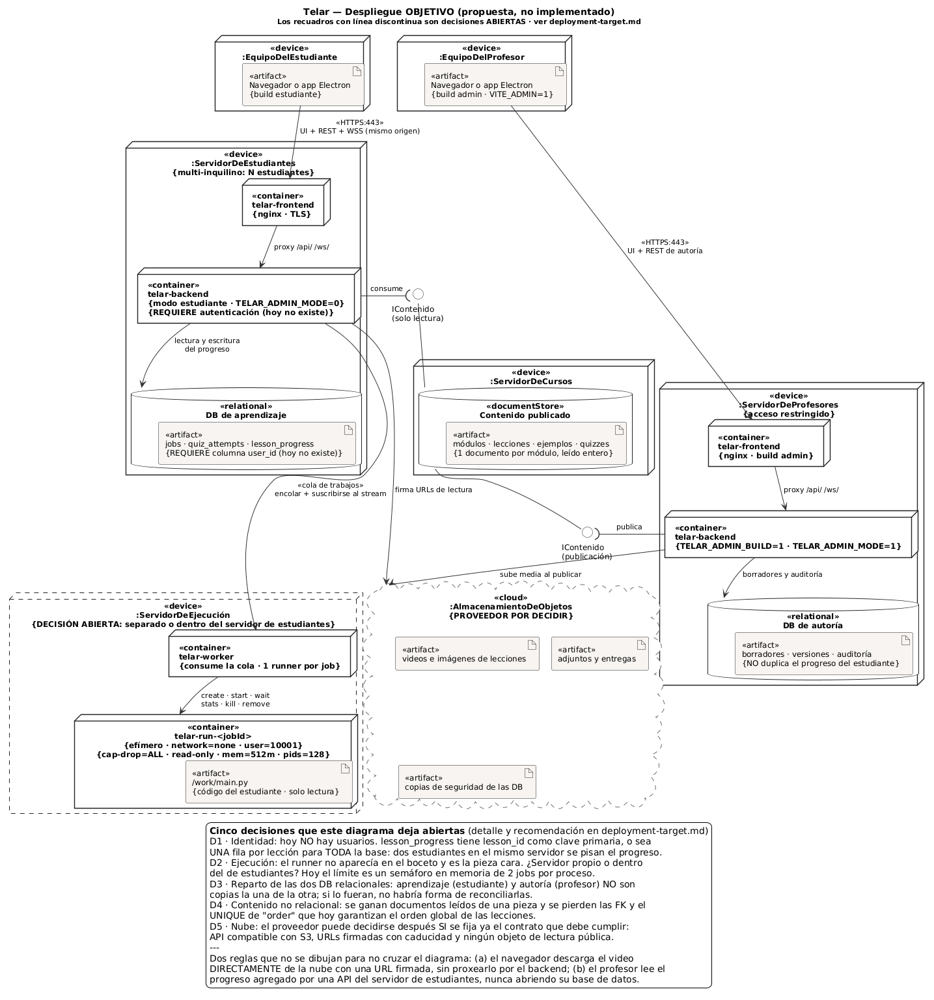

# Telar — Despliegue objetivo (PROPUESTA)

> **Esto no es un contrato ni describe el repo actual.** Es una propuesta de
> arquitectura para el despliegue distribuido de tres servidores más
> almacenamiento en nube. El estado **implementado y verificado** está en
> [`deployment-diagram.md`](deployment-diagram.md); los contratos congelados, en
> `api-contract.md` y `data-model.md`. Nada de este documento manda sobre ellos.



Fuente: [`diagrams/despliegue-objetivo.puml`](diagrams/despliegue-objetivo.puml)
· SVG: [`despliegue-objetivo.svg`](../assets/deployment/despliegue-objetivo.svg)

## 0. El salto que se está proponiendo

Telar hoy es una aplicación **local y de un solo usuario**. No es un detalle de
configuración: es el supuesto sobre el que descansan tres decisiones de diseño
que están escritas en el código y justificadas por escrito.

| Decisión actual | Justificación literal en el repo | Qué la sostiene |
|---|---|---|
| El backend **no tiene autenticación** | `config.py`: «app local en loopback distribuida solo a administradores; sin login/token» | que solo escuche en `127.0.0.1` |
| El backend monta `/var/run/docker.sock` y corre como **root** en su contenedor | `backend/Dockerfile`: «riesgo aceptado y documentado» | «el bind a loopback y el sandbox del runner» |
| Todos los puertos ligados a `127.0.0.1` | `compose.yaml`: «publicarlo en `0.0.0.0` expondría ejecución de código y el historial a toda la LAN» | — |

Poner esto en un servidor accesible por red **retira el soporte de las tres a la
vez**. Un `ServidorDeEstudiantes` con la configuración de hoy es un servicio de
ejecución de código arbitrario, sin autenticar, con el socket de Docker montado.
No es un riesgo teórico ni una tarea de "endurecimiento" para el final: es el
primer requisito del despliegue distribuido.

Por eso el diagrama objetivo añade dos cosas que el boceto no tenía: la
**autenticación** como restricción explícita del backend de estudiantes, y un
**servidor de ejecución** separado donde vive el socket.

---

## 1. Las cinco decisiones abiertas

Cada una lleva la evidencia del código, el impacto y una recomendación. Están en
orden de dependencia: D1 bloquea a las demás.

### D1 · Identidad: hoy no existe el concepto de "estudiante"

**Evidencia.** En `backend/app/schema.sql`:

```sql
CREATE TABLE IF NOT EXISTS lesson_progress (
    lesson_id  TEXT PRIMARY KEY,   -- ← UNA fila por lección, para TODA la base
    ...
);
```

`lesson_id` es la clave primaria. No hay `user_id` en `lesson_progress`, ni en
`quiz_attempts`, ni en `jobs`. La base de datos no modela un estudiante: modela
**el** estudiante, en singular.

**Impacto.** En cuanto dos estudiantes compartan el `ServidorDeEstudiantes`, el
segundo sobrescribe el progreso del primero, silenciosamente y sin error: el
`upsert` de `lesson_progress` es correcto para un usuario y corrupto para dos.
Los intentos de quiz y los jobs se mezclan en un único historial.

**Recomendación.** Es una migración de esquema, la `migration 5`:

- Tabla `users` (id, identificador externo, rol).
- `user_id` en `jobs`, `quiz_attempts` y `lesson_progress`.
- La clave primaria de `lesson_progress` pasa a ser `(user_id, lesson_id)`.
- Los índices existentes se recrean con `user_id` al frente.

Y autenticación real en el backend. El modo admin **no sirve** para esto:
`TELAR_ADMIN_MODE` es una variante de despliegue (un flag de proceso), no una
sesión de usuario; distingue dos *artefactos*, no dos *personas*.

Nótese que `jobs.source_code` guarda el snapshot del código del estudiante. Sin
`user_id` no solo se mezcla el historial: no hay forma de decir de quién es cada
envío, ni de aplicarle una cuota.

### D2 · Dónde se ejecuta el código del estudiante

**Evidencia.** El boceto no incluía el runner, que es la pieza cara y la razón de
ser del sistema. Hoy el límite de concurrencia es
`asyncio.Semaphore(settings.max_concurrent_jobs)` con `max_concurrent_jobs = 2`
(`job_runner.py`): **un semáforo en memoria, dentro de un proceso uvicorn**.

**Impacto.** Dos cosas se rompen a la vez al pasar a N estudiantes:

1. El techo de 2 jobs simultáneos deja de ser "el estudiante no se pisa a sí
   mismo" y pasa a ser "toda la universidad hace cola de dos en dos". Y como el
   semáforo vive en memoria, no sobrevive ni a un reinicio ni a una segunda
   réplica del backend.
2. El proceso que atiende peticiones de red es el mismo que tiene el socket de
   Docker. Cualquier fallo de autenticación o de validación en la API es
   ejecución de código en el anfitrión.

**Recomendación.** Separar la ejecución, que es lo que dibuja el nodo
`ServidorDeEjecución`:

- El backend **encola** el job y se suscribe al stream; nunca toca el socket.
- Un `telar-worker` consume la cola y es el único con acceso al daemon.
- La concurrencia pasa a ser una propiedad de la cola (y admite cuota por
  usuario), no una variable de proceso.
- El sandbox del runner **no cambia**: las constantes de `docker_service.py`
  siguen siendo correctas y siguen siendo la última línea de defensa.

Si por coste se decide no separar la máquina, el worker debe seguir siendo un
**proceso distinto** del que atiende la red, aunque compartan anfitrión. Lo que
no puede quedarse es "el backend expuesto a internet con el socket montado".

### D3 · Qué guarda cada una de las dos bases relacionales

**Evidencia.** Hoy hay **una** base y se comparte a propósito entre las dos
variantes de despliegue. El `compose.yaml` lo dice en el volumen:

```yaml
  # name: explícito para compartir el MISMO volumen de datos entre despliegues
  # (estudiante / admin) y desactivar el prefijo del proyecto Compose.
  telar_data:
    name: telar_data
```

**Impacto.** El boceto dibuja una base relacional en cada servidor. Si ambas
tuvieran las mismas tablas serían dos copias divergentes sin ruta de
reconciliación: el profesor vería un progreso distinto del que el estudiante
generó, y no habría forma de decidir cuál gana.

**Recomendación.** Que no sean copias, sino **responsabilidades distintas**:

| Base | Servidor | Contenido |
|---|---|---|
| DB de aprendizaje | estudiantes | `jobs`, `quiz_attempts`, `lesson_progress` (con `user_id`) |
| DB de autoría | profesores | borradores, versiones publicadas, auditoría de cambios |

El profesor consulta el progreso agregado **por una API** del servidor de
estudiantes, no abriendo su base de datos. Una réplica de solo lectura es la
alternativa si los informes pesan, pero es una optimización posterior: empieza
por la API, que además es lo único que puede filtrar por permisos.

### D4 · Contenido en base no relacional

**Evidencia.** El contenido hoy son cuatro tablas relacionales creadas en la
`migration 2` (`modules`, `lessons`, `examples`, `quiz_questions`) con garantías
que las impone el motor:

- `lessons."order" INTEGER NOT NULL UNIQUE` — orden **global**, único entre todas
  las lecciones de todos los módulos.
- `quiz_questions UNIQUE (lesson_id, "order")`.
- `FOREIGN KEY ... ON DELETE CASCADE` de lecciones a módulos y de ejemplos y
  preguntas a lecciones.
- `CHECK` de rangos (`difficulty BETWEEN 1 AND 5`, `pass_threshold`…) y
  `json_valid` en las listas opacas.

**El cambio es razonable**, y conviene decir por qué: el contenido se **lee
entero** (el catálogo completo por pantalla) y lo **escribe un solo autor**. Esa
es exactamente la forma de un documento por módulo, y aporta algo que hoy no se
tiene: publicar pasa a ser sustituir un documento versionado de forma atómica, así
que el estudiante nunca lee un catálogo a medio escribir.

**Lo que se pierde** hay que escribirlo antes de migrar, no descubrirlo después:
las cuatro garantías de arriba dejan de estar en el motor y pasan a ser
responsabilidad del código de escritura. La buena noticia es que la pieza ya
existe (`services/content_writer.py`, `services/markdown_validator.py`,
`tools/validate_content.py`); la mala es que hoy se apoya en que la base
rechazaría un `order` duplicado.

**Recomendación.** Adelante, con dos condiciones: (a) lista escrita de los
invariantes que dejan de ser DDL, cada uno con su validación en el escritor y su
test; (b) el `seed_content` y `validate_content` se adaptan como puerta de
publicación, no como script de arranque.

### D5 · Almacenamiento en nube (proveedor por decidir)

**Evidencia.** Que el proveedor esté sin decidir **no bloquea nada**, porque el
punto de extensión ya existe. En `frontend/src/features/learn/lessonVideos.ts` la
fuente de video admite dos formas, y una es una URL externa absoluta:

```
//   1) URL externa:   'https://cdn.ejemplo.com/leccion.mp4'
//   2) .mp4 EN DISCO:  ruta relativa a `public/`
```

La forma (2) es la que hay que abandonar: los `.mp4` en `frontend/public/` entran
en el build de Vite y, por tanto, **dentro del instalador de escritorio**.

**Recomendación.** Decide ahora el **contrato**, y el proveedor cuando quieras:

| Requisito | Por qué |
|---|---|
| API compatible con S3 | es lo que hablan todos los candidatos; evita atarse |
| URLs firmadas con caducidad | el contenido no es público y no debe serlo |
| El navegador descarga **directo** de la nube | proxear video por el backend malgasta su ancho de banda y bloquea workers |
| Ningún objeto con lectura pública | — |
| Subida solo desde el backend de profesores | el de estudiantes solo **firma** URLs de lectura |

Qué vive ahí: media de lecciones, adjuntos y entregas, y las copias de seguridad
de las dos bases relacionales.

---

## 2. Lo que NO debería cambiar

Merece la pena decirlo, porque en una migración así es fácil tocarlo "de paso":

- **Las constantes del sandbox del runner** (`docker_service.py` §4). Siguen
  siendo correctas y pasan a ser más importantes, no menos: en un servidor
  compartido son lo único que separa el código de un estudiante del de otro.
- **Un único build del frontend** para web y escritorio, con `API_BASE`/`WS_BASE`
  resueltos en runtime (`frontend/src/config.ts`). El despliegue distribuido no
  obliga a bifurcarlo.
- **El modo escritorio**. No es un paso intermedio a jubilar: es el despliegue que
  funciona sin red y sin servidor, y sigue siendo la mejor respuesta para un
  estudiante con su propia máquina. Los cuatro modos pueden convivir.
- **La separación estudiante/autoría por ausencia de código** (`TELAR_ADMIN_BUILD`
  borra los módulos admin del artefacto). Con dos servidores encaja aún mejor:
  cada uno despliega su imagen.

---

## 3. Orden de trabajo sugerido

Las dependencias mandan y hay una sola forma sensata de encadenarlo:

1. **Identidad y autenticación (D1).** Bloquea todo lo demás: sin `user_id` no
   hay servidor multi-inquilino, ni cuotas, ni informes por estudiante.
2. **Separar la ejecución (D2).** En cuanto la API mire a la red, el socket de
   Docker no puede seguir en el mismo proceso.
3. **Partir las bases (D3)** y mover el contenido al almacén documental **(D4)**,
   en ese orden: primero se decide qué guarda cada quien, después se cambia el
   motor.
4. **Nube (D5).** Se puede hacer en cualquier momento —el frontend ya acepta URLs
   externas— pero conviene antes de que existan vídeos reales, para no meterlos
   nunca en el build.

Los pasos 1 y 2 son los que convierten Telar de aplicación local en servicio.
Los pasos 3, 4 y 5 son mejoras de arquitectura que se pueden hacer con calma.

---

## 4. Preguntas que hay que responder antes de dibujar la versión definitiva

No las contesto por ti porque cambian el diagrama, no el detalle:

1. **¿"Servidor de estudiantes" es uno para todos, o uno por aula/curso?** Cambia
   si el aislamiento entre grupos es una fila en la base o una máquina.
2. **¿Quién autentica?** ¿Cuentas propias o el proveedor de identidad de la
   universidad (SSO/OIDC)? Si es el segundo, `users` guarda el identificador
   externo y no contraseñas.
3. **¿Cuántos jobs concurrentes hay que sostener en hora punta?** Es el único
   número que dimensiona el servidor de ejecución: cada runner reserva
   `threads` CPUs y 512 MB.
4. **¿El profesor necesita ver el código de los estudiantes, o solo agregados?**
   Cambia el contrato de la API de informes y tiene implicaciones de privacidad.
5. **¿Se mantiene el despliegue de escritorio en paralelo?** Si sí, hay que
   decidir si sincroniza progreso contra el servidor o se queda local.
